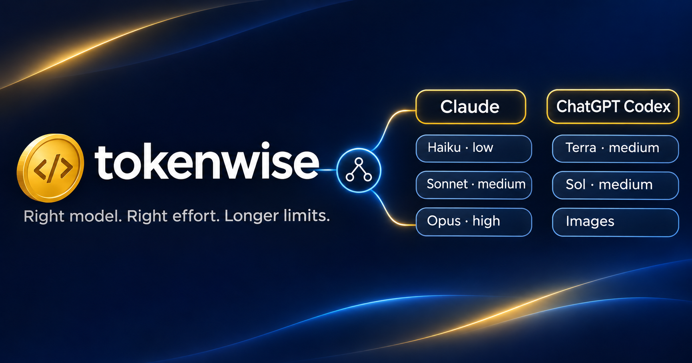

# 🪙 tokenwise



**An open-source model routing skill for Claude Code, Codex CLI and Gemini CLI.**

tokenwise is a skill for Claude Code, Codex CLI and Gemini CLI that helps choose a suitable **model** and **reasoning effort** for each part of a task. Optional provider CLIs can handle delegated work; an image-capable Codex setup can generate images. Availability depends on the host and your accounts. Simple tasks stay in the main session when delegation would add unnecessary overhead.

[](LICENSE)


**Works in:** Claude Code · OpenAI Codex CLI · Google Gemini CLI. Use the skill inside your existing agent in the terminal or a supported IDE integration; IDE support depends on the host. Optional provider CLIs let supported agents hand suitable work to another provider. Want a separate desktop and local web UI with worktrees and per-file review? See [tokenwise studio](https://github.com/OnurSamett/tokenwise-studio). Use either independently or both together. Website: [tokenwise.site/skill](https://tokenwise.site/skill/).

[Türkçe açıklama](#-türkçe)

---

## Why

If you're on a Claude plan, you've probably hit the usage limit in the middle of something important. A big part of that usage goes to work that never needed the most expensive model: searching files, reading logs, writing boilerplate, running tests.

The numbers behind it (Terminal-Bench 4.0, a snapshot; see the [official board](https://hub.harborframework.com/datasets/terminal-bench/terminal-bench/4?tab=leaderboard&leaderboard=4-0-0) for current scores):

- A free model can tie a paid one: DeepSeek V4.1 Flash (free on NVIDIA) scores 40.0, the same as Claude Haiku 5.5.
- GPT-6.1 Sol and GPT-6 Astra both score 58.2, and Sol costs about one fifth as much.
- Claude Opus 5.5 scores 64.8, so keep it for design and unknown bugs.

tokenwise splits the work:

- 🔍 **Mechanical work** (search, logs, boilerplate) → **Haiku**, low effort
- 🛠️ **Routine coding** (features from a plan, tests, refactors) → **Sonnet**, effort by size
- 🧠 **Hard thinking** (architecture, unknown bugs, security) → **Opus**, effort by risk

And it **doesn't over-delegate**: subagents start cold and re-read context, so small tasks stay in the main session.

## Measuring usage and cost

The same task can use different amounts of tokens and cost depending on routing, model and effort. Compare against a baseline and check output quality; delegation can add overhead. API-equivalent costs are estimates, not subscription charges. See [the benchmark method](bench/README.md).

## How it decides

Two independent questions for every piece of work:

```
            ┌───────────────────────────────┐
  task ───▶ │ 1. What kind of intelligence? │ ──▶  haiku │ sonnet │ opus
            └───────────────────────────────┘
            ┌───────────────────────────────┐
            │ 2. How long should it think?  │ ──▶  low │ medium │ high │ xhigh
            └───────────────────────────────┘
                 ▲ steps · ambiguity · prior failure · cost of a mistake
```

**Effort** goes up one step for each signal present:

| Signal | Question |
|--------|----------|
| Steps | How many files/parts interact? |
| Ambiguity | Is the answer clear, or must it be investigated? |
| Prior failure | Did an earlier attempt fail? |
| Cost of a mistake | Is a wrong answer hard to undo? |

So **Opus/low** is a real option (a quick design question: needs judgment, not long thinking), and so is **Sonnet/high** (a big but routine refactor).

### Cheat sheet

| | `low` | `medium` | `high` |
|---|---|---|---|
| **Haiku** | find files, grep, run tests | read a long log, find the error | — move to Sonnet |
| **Sonnet** | small single-file fix | feature from a plan, tests | 5+ file refactor, failed once |
| **Opus** | quick design check, tiny diff review | pick an architecture, PR review | unknown bug, system design |

~50 more examples by category (search, coding, tests, debugging, review, design, docs, SQL, DevOps) live in [`effort-guide.md`](skills/tokenwise/references/effort-guide.md).

### Escalation ladder

When something fails, tokenwise climbs **effort before model**:

```
haiku/low → haiku/medium → sonnet/medium → sonnet/high → opus/high → opus/xhigh
```

`max` is never used unless you ask for it.

## ChatGPT Codex and Gemini as extra workers (optional)

Got the [OpenAI Codex CLI](https://github.com/openai/codex) or [Gemini CLI](https://github.com/google-gemini/gemini-cli) signed in? tokenwise can hand work to them, and that costs **zero Claude usage**:

- 🎨 **Image generation** (through an image-capable Codex setup): icons, banners, OG/social images, illustrations. Codex generates the file and Claude checks it. *The cover image above was made this way.*
- 🔎 **Second opinions** on high-stakes design or review decisions, from a different model family.
- 📝 **Self-contained text work** (summaries, drafts, translations, test data) when your Claude limits are tight.

Codex models are routed the same way. Defaults are **sol/medium** for questions and second opinions and **terra/medium** for images (a public test of GPT-6.1 Terra found medium as accurate as high and no costlier than low: https://nerdschalk.com/gpt-6-1-terra-codex-reasoning-effort/). **luna** is only used on request (`-m luna`, trivial tasks). **astra** drains ChatGPT limits fast, so it's **blocked unless you opt in** with `TOKENWISE_CODEX_ASTRA=1` (e.g. on a Pro plan).

Safety rails: workers run read-only or in an isolated temp folder, never get secrets, and their output is treated as untrusted and verified by Claude.

```bash
npm install -g @openai/codex && codex login           # images + second opinions
agy   # Gemini via Google Antigravity (in Gemini.app on macOS): run once to sign in with Google
# or: npm install -g @google/gemini-cli && export GEMINI_API_KEY=...   (Gemini CLI's own Google sign-in no longer works for individuals)
brew install ollama && ollama pull gpt-oss:20b        # local fallback: free, unlimited, full agent (via Codex --oss)
# free API fallback (read-only text): set NVIDIA_API_KEY (build.nvidia.com), OPENROUTER_API_KEY, GROQ_API_KEY or MISTRAL_API_KEY, and TOKENWISE_ALLOW_FREE=1
```

All of these are optional; tokenwise works fine without them. When a paid plan runs out, work falls back automatically in the order codex → gemini → claude → local (Ollama) → free API.

## What you'll see

At the end of a turn where work was delegated, one line:

```
Model routing: haiku/low (search), opus/low (quick design check), sonnet/high (6-file refactor), codex (OG image); main: opus/medium.
```

And when a long stretch of simple work is ahead, a **suggestion** (never a silent switch) to drop the main session to Sonnet or a lower effort.

## What's inside

| File | What it is |
|------|------------|
| `skills/tokenwise/SKILL.md` | The routing rules Claude follows |
| `skills/tokenwise/references/effort-guide.md` | ~50 task → model/effort examples |
| `skills/tokenwise/scripts/external.sh` | Codex/Gemini bridge: `check`, `image`, `ask` |
| `hosts/agents/SKILL.md` | The Codex CLI / Gemini CLI version of the skill |
| `agents/tokenwise-scout.md` | Haiku, read-only: search, logs, summaries |
| `agents/tokenwise-builder.md` | Sonnet: implementation, tests, refactors |
| `agents/tokenwise-architect.md` | Opus: design, hard bugs, reviews |

## Want a UI? → tokenwise studio

[**tokenwise studio**](https://github.com/OnurSamett/tokenwise-studio) is a separate desktop and local web app for orchestrating workers, reviewing changes from isolated git worktrees, and viewing usage. The tokenwise skill runs inside your coding agent instead, including supported terminal or IDE workflows. Each works independently; you can also use them together.

## Install

**Everything at once (Claude Code + Codex + Gemini, whichever you have):**

```bash
git clone https://github.com/OnurSamett/tokenwise.git && ./tokenwise/install.sh
```

- **Claude Code** → `~/.claude/skills/tokenwise` + 3 subagents
- **Codex CLI** → `~/.codex/skills/tokenwise`
- **Gemini CLI** → linked with `gemini skills link`

Only some of them? `./tokenwise/install.sh codex gemini`.

**Claude Code plugin only:** run these inside Claude Code:

```
/plugin marketplace add OnurSamett/tokenwise
/plugin install tokenwise@tokenwise
```

Start a new session in each tool afterwards.

### Cross-agent workers

Whichever agent you're in, tokenwise can hand self-contained work to the others through `scripts/external.sh`:

| From \ To | Claude (`haiku`/`sonnet`/`opus`) | Codex (`terra`/`sol`) | Gemini |
|---|---|---|---|
| Claude Code | subagents | ✅ + images | ✅ |
| Codex CLI | ✅ | cheaper Codex models | ✅ |
| Gemini CLI | ✅ | ✅ + images | — |

So when one plan's limit is getting tight, Light/Standard work can move to another plan you already pay for.

## Use

Nothing to do: it triggers on multi-step tasks and whenever you mention limits, usage or cost. To call it explicitly: `/tokenwise`.

## FAQ

**Does it enforce limits?** No. It's guidance Claude follows, not a hard cap. It routes by task type, not by your remaining quota.

**Won't subagents cost more?** They can, which is why tokenwise only delegates self-contained work that would take ~5+ tool calls or lots of reading. Small things stay inline.

**Why not `fork` subagents?** Forks always run on the parent's model, so they don't save anything.

**Does it work with ultracode?** Yes. With `/effort ultracode` you've chosen maximum effort and automatic multi-agent orchestration, so tokenwise doesn't argue with that: it won't suggest lowering effort, but it still gives the purely mechanical worker pieces (search, log reading, boilerplate) to Haiku/Sonnet and sends images to Codex. Note: ultracode is expensive by design; tokenwise trims around it, it doesn't make it cheap.

**Will it change my model behind my back?** No. Main-session model/effort changes are only suggested; you decide.

## Contributing

Better examples for the effort guide, new agent roles, real-world numbers on savings: PRs and issues welcome.

---

## 🇹🇷 Türkçe

**tokenwise, Claude ve ChatGPT limitlerini daha uzun süre idare etmeni sağlar, hem de işin kalitesini düşürmeden.**

Her iş parçası için iki karar verir:
- **Hangi model?** Arama ve log okuma Haiku'ya, normal kodlama Sonnet'e, mimari ve zor hatalar Opus'a gider.
- **Ne kadar efor?** Adım sayısı, belirsizlik, önceki başarısızlık ve hatanın bedeline göre low, medium, high ya da xhigh seçilir.

Örneğin Opus/low da mümkündür: kısa bir tasarım sorusu akıl ister ama uzun düşünme gerektirmez. Sonnet/high da mümkündür: sıradan ama çok dosyalı bir refactor.

Codex ya da Gemini CLI kuruluysa görsel üretimini (Claude görsel üretemez), ikinci görüş almayı ve bağımsız metin işlerini onlara devreder. Bunlar Claude limitinden hiç harcamaz.

Claude Code, Codex CLI ve Gemini CLI'ın üçünde de çalışır: tek komutla hepsine kurulur ve her ajan diğerlerine iş devredebilir. Bir planın limiti daralınca işler zaten ödediğin diğer plana kayar.

Küçük işler için alt ajan açmaz, çünkü alt ajan sıfırdan başlar ve o da token harcar. Ana oturumun modelini ya da eforunu kendi başına değiştirmez, yalnızca önerir.

**Kurulum:** yukarıdaki iki yoldan biriyle kur, sonra yeni bir oturum aç.

## Status and trademarks

Version 0.9, the same release as tokenwise studio. Tested with Claude Code and Codex CLI; Gemini CLI is wired up but less tested. The skill is Markdown plus a shell script (`external.sh` needs bash), so Linux should work; only macOS is tested. Provider and model names are used only to identify the tools. This project is not affiliated with, endorsed by, or sponsored by OpenAI, Anthropic, Google, NVIDIA or any other provider named.

## License

MIT
